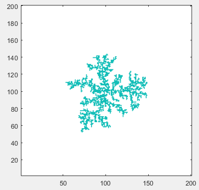
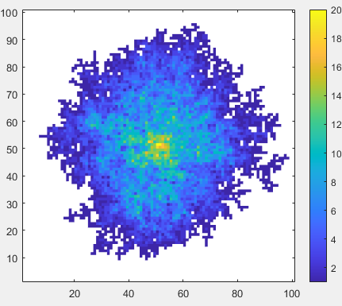
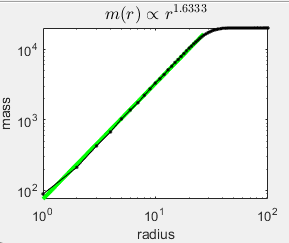

General information about the CTL course available at https://ctl.polyphys.mat.ethz.ch/

# :wave: PROJECT Diffusion-limited aggregation

Diffusion-limited aggregation (DLA) and related computational models provide you with a  way to connect fundamental physical processes with the emergence of complex microstructures. Many materials form through competing processes involving diffusion, nucleation, aggregation, and growth, and DLA offers a simple yet powerful framework for exploring how local, stochastic interactions can produce large-scale structures with characteristic morphology and fractal behavior. Implementing such models also develops practical skills in computational materials science, including stochastic simulation, lattice-based modeling, visualization, statistical analysis, and the extraction of physical quantities such as fractal dimension. By experimenting with parameters and growth rules, you can investigate how microscopic transport and growth mechanisms influence macroscopic structure, providing an intuitive bridge between mathematical models and real materials phenomena such as electrodeposition, solidification, crystal growth, porous structures, and aggregation processes.

# Task 1: to be completed by every group

## Task 1.1

Create a (*L+1*) *x* (*L+1*) regular **2D** grid filled with zeros (= empty). The grid spacing is assumed to be 1. 
A so-called seed particle (unit cell with value 1) is added in the center of the grid, and it will remain there forever. This seed particle is the first member of an emerging cluster of particles. Next, a so-called random walker (cell with value 1) starts at a 
random, still empty, position on the grid. The walker makes random steps in any of the 4 directions (taking into account periodic boundary conditions) until it touches the existing cluster. At this moment, the walker becomes part of the growing cluster. Add $N-1$ more random walkers the same way until the cluster contains *N+1* particles (the seed particle plus *N* random walkers). Choose *L*=200 and *N*=1000. Visualize the resulting cluster (as shown below). Measure the cpu time required to run this simulation.

## Task 1.2

Same as Task 1.1, but do not insert walkers at random empty grid nodes. Instead, insert them randomly on a circle with radius *R+1*, where *R* is the current maximum extension of the cluster, measured from the position of the seed particle. Choose again *L*=200 and *N*=1000. Visualize the resulting cluster. Measure the cpu time required to run this simulation and compare with the cpu time obtained in Task 1.1. 

## Task 1.3

Here we are interested in the fractal dimension of the created structures. To estimate this dimension, it is not enough to create a single cluster, but you have to take an average over multiple clusters. To this end adjust the functions created in Tasks 1 and 2 to return the resulting (*L+1*) *x* (*L+1*) grid containing the single cluster (cells with value 1, all other cells have value 0). Start this routine *M* times and add the resulting grids to obtain an accumulated grid $G$ with values between 0 and *M*. Visualize the structure represented by the accumulated grid *G* (example shown below). 

Calculate the fractal dimension of this structure as follows. For a given distance *r* from the seed particle, calculate the mass *m(r)* contained within the circle of radius *r*, centered at the seed particle. A mass of a grid node is simply the value of *G* at this node. Create a double-logarithmic plot *m(r)* versus *r*. It should exhibit an initial linear increase, followed by a leveling off to a constant value *mfinal* (this value is known from *M* and *N*), as shown below. 

Determine the fractal dimension *Df* governing the initial linear increase (green line) via its defining relationship 

  *m(r) &propto; rDf* 
  
by taking into account only those *r* values that correspond to *m(r)&le;0.8 mfinal*. Also estimate the error bar for *Df*. Since you have two functions to choose from (the ones from Task1 and Task2), obtain *Df* using a sufficiently large *M* and compare the two results. 

## Task 1.4

Based on the routines developed in Task 1.1 and 1.2, create movies that show how walkers walk and attach to an existing cluster. 

# Task 2: freely choose one (or more) from the sub-tasks

## Task 2.1

Instead of working with a regular 2D grid, seed and walker particles are now filled circles of unit radius within a 2D square (periodic) box of size (*L+1*) *x* (*L+1*). Walkers are inserted as before -- either (A) randomly or (B) on a circle with dynamically varying radius -- without overlap with the existing cluster, but at each iteration they take a random step (random direction, random step length between 0 and 1) instead of jumping to an adjacent grid node. If such step leads to an overlap of the walker with the existing cluster, reduce the length of the last step so that the walker just touches the existing cluster, to which it has now been added. Note that a walker may overlap with several existing members of the cluster at the same time. In that case, the length of the last step has to be reduced in accord with the nearest member to ensure that particles of the cluster do not overlap. Choose *L*=200 and *N*=1000. Visualize the resulting cluster. Measure the cpu time required to run this simulation in modes (A) and (B), and calculate the fractal dimensions (as for Task 1.3).

## Task 2.2

Explore the effect of initial walker positions on the generated structures and fractal dimension. Walkers may be inserted on a radius with fixed value, they may be inserted at the box boundaries, or as in Tasks 1.1 and 1.2, randomly, or at a dynamically growing radius. How does this affect results? 

## Task 2.3

Same as Task 1 but now in 3D. 

## Task 2.4

Investigate the effect of number of walkers on the fractal dimension and try to estimate the fractal dimension in the limit or infinitely large amount of walkers (the box size has to be adjusted accordingly). 

## Task 2.5

Same as Task 1.1 using multiple seed particles in 2D. Walkers can then attach to any of the clusters. Explore the resulting structures, visualize them, and create movies. 

## Task 2.6 (advanced)

Consider multiple seed particles as in Task 2.4. While clusters were so far immobile, they are now allowed to move (translate, rotation is even more difficult and makes most sense only if the off-lattice version is chosen) as a rigid object. The rigid clusters move in any direction, if they touch, they form a single cluster. As the clusters are allowed to move, the simulation ends as soon as the simulation box contains a single cluster. 
